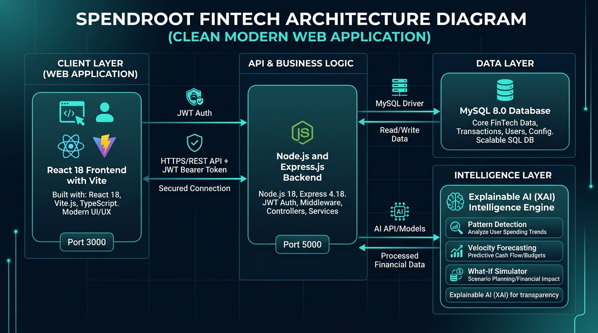

# System Architecture



## 1. Architecture Overview

SpendRoot is a **full-stack financial behavior optimization platform** developed for the URAN 2026 FinTech Track FT-01 challenge.

The repository contains a working full-stack implementation:

- **Frontend**: React 18, Vite, React Router, Tailwind CSS, Recharts, Lucide React
- **Backend API**: Node.js, Express.js REST API with Helmet, Morgan, and CORS
- **Database**: MySQL 8.0 relational database (`uran_ft01`) with connection pooling and unified storage adapter
- **AI / Intelligence Engine**: Rule-based and statistical engine in `backend/src/services/intelligenceEngine.js` for sequence pattern detection, anomaly detection, velocity forecasting, and What-if simulation
- **Authentication**: JWT token authentication with bcrypt password hashing
- **Security**: User ownership isolation (`user_id === authenticated_user.id`), parameterized SQL queries

The implemented architecture is:

```text
USER (Browser)
      │
      ▼
React Web Application (Port 3000)
      │
      ▼  HTTP REST (JSON) + Authorization: Bearer <JWT>
Express.js REST API (Port 5000)
      │
      ├───────────────────────┬───────────────────────┐
      ▼                       ▼                       ▼
Controllers & Middleware   Intelligence Engine     Database Adapter
(Auth, Tx, Budgets,       (Sequences, Anomaly,   (MySQL 8.0 / Pool)
 Goals, Dashboard)         Forecasting, What-If)      │
      │                       │                       ▼
      └───────────────────────┴───────────────> MySQL Database (`uran_ft01`)
```

---

## 2. Components

| Component | Responsibility | Technology |
|---|---|---|
| Frontend | Responsive web interface, navigation, forms, dashboards, charts, transaction management, budgets, goals, insights, simulator, CSV import, and monthly summary | React 18.3.1, Vite 5.4.6, React Router 6.26.2, Tailwind CSS 3.4.11, Recharts 2.12.7, Lucide React |
| Backend | REST API layer for JWT auth, transactions, budgets, goals, analytics, pattern intelligence, CSV import, and settings | Node.js, Express.js, JWT, bcryptjs, express-validator, helmet, cors |
| Database | Relational storage for users, transactions, budgets, goals, settings, patterns, and recommendations | MySQL 8.0 (`uran_ft01`) with unified query adapter |
| AI / ML | Explainable intelligence using temporal sequence correlation, statistical anomaly z-score, velocity forecasting, and What-if simulation | Deterministic & statistical engine in `backend/src/services/intelligenceEngine.js` |
| External API | None (Self-contained synthetic fintech sandbox) | None |

### Current source structure

```text
src/
├── components/
│   ├── common/
│   ├── dashboard/
│   └── layout/
├── context/
│   └── FinanceContext.jsx
├── pages/
│   ├── DashboardPage.jsx
│   ├── TransactionsPage.jsx
│   ├── ImportPage.jsx
│   ├── BudgetsPage.jsx
│   ├── GoalsPage.jsx
│   ├── InsightsPage.jsx
│   ├── SimulatorPage.jsx
│   ├── MonthlySummaryPage.jsx
│   ├── LoginPage.jsx
│   ├── RegisterPage.jsx
│   └── SettingsPage.jsx
├── services/
│   ├── csvParser.js
│   ├── intelligenceEngine.js
│   └── mockData.js
├── App.jsx
├── main.jsx
└── index.css
```

---

## 3. Data Flow

### 3.1 Transaction entry flow

```text
Manual transaction entry
        │
        ▼
AddTransactionModal / TransactionsPage
        │
        ▼
FinanceContext
        │
        ▼
api.js (POST /api/transactions + Bearer JWT)
        │
        ▼
Express transactionController
        │
        ▼
MySQL Database (INSERT INTO transactions)
        │
        ▼
Success response
        │
        ▼
React state updated
        │
        ▼
Real-time dashboard recalculation + AI intelligence update
```

### 3.2 CSV import flow

```text
CSV file
   │
   ▼
ImportPage
   │
   ▼
csvParser.js (Client validation, format check)
   │
   ▼
api.js (POST /api/import/transactions)
   │
   ▼
Express importController
   │
   ├── Validate fields & categories
   ├── Deduplicate against existing records
   └── Batch insert into MySQL database
   │
   ▼
FinanceContext state updated
   │
   ▼
Dashboard / Transactions / Budgets refreshed
```

### 3.3 Intelligence flow

```text
Transactions + Budgets + Goals
              |
              v
     intelligenceEngine.js
              |
      +-------+--------+----------------+
      |       |        |                |
      v       v        v                v
Categorize  Budget   Pattern        What-if
            Projection Detection    Simulation
      |       |        |                |
      +-------+--------+----------------+
              |
              v
       Insights / Recommendations
              |
              v
        Dashboard + Simulator
```

### 3.4 Current behavior-analysis example

SpendRoot can identify repeated transaction sequences such as:

```text
Late-evening Transport
          |
          | within a configured time window
          v
Food Delivery
```

When repeated sequences are present, the intelligence layer can produce an explainable pattern containing observable evidence, occurrence information, and an estimated financial impact.

The application presents this as a **detected/repeated pattern**, not as proof of causation.

### 3.5 What-if simulation flow

```text
Current financial state
        |
        v
User changes simulation control
        |
        v
Simulation calculation
        |
        +--> projected expense
        +--> projected savings
        +--> budget effect
        +--> savings-goal effect
        |
        v
Interactive result shown in SimulatorPage
```

The current simulator is non-destructive until the user chooses an action that changes the application state.

---

## 4. Security / Privacy Considerations

### Current prototype safeguards

1. **Synthetic/demo financial data only**
   - The prototype does not require real bank credentials.
   - No live bank account or production payment information is processed.

2. **Client-side input validation**
   - Transaction forms validate required fields and basic numeric/date constraints.
   - CSV import reports invalid or incomplete records before valid records are imported.

3. **Duplicate detection**
   - Imported transaction records are checked for likely duplicate entries.

4. **No external financial APIs**
   - The current prototype does not transmit financial data to an external banking or payment service.

5. **Environment-variable discipline**
   - The repository contains `.env.example` only for variable names.
   - Real secrets, passwords, API keys and tokens must not be committed.

6. **Demo-only authentication**
   - The current Login/Register screens provide a frontend demonstration flow.
   - They do not yet provide production-grade server-side authentication or authorization.

### Implemented Backend Security Safeguards

The implemented Node.js + Express.js + MySQL backend incorporates:

```text
HTTP Request
  │
  ▼
Helmet (HTTP Headers Security)
  │
  ▼
CORS (Origin validation for http://localhost:3000)
  │
  ▼
Authentication Middleware (Bearer JWT verification)
  │
  ▼
User Ownership Isolation (user_id === authenticated_user.id)
  │
  ▼
Input Validation & Sanitization (express-validator)
  │
  ▼
Parameterized MySQL Queries (Protection against SQL Injection)
  │
  ▼
MySQL Database (uran_ft01)
```

Key security practices implemented:
- Passwords hashed using `bcryptjs` with salt rounds. Plain-text passwords are never stored.
- Multi-user isolation enforced on all transaction, budget, goal, and analytical queries.
- SQL queries parameterized using MySQL2 prepared statements (`?` placeholders).
- Centralized error-handling middleware ensures database stack traces and credentials are never leaked to clients.
- Environment variables (`.env`) used for all sensitive configuration (port, credentials, JWT secret).

---

## 5. System Architecture Summary

The complete full-stack application data flow is:

```text
User (Browser)
      │
      ▼
React 18 Web Application (Port 3000)
      │
      ▼  REST API (JSON) + Authorization: Bearer <JWT>
Express.js REST API Server (Port 5000)
      │
      ├──────────────────────┬──────────────────────┐
      ▼                      ▼                      ▼
 Route Controllers     Intelligence Engine    Database Adapter
 (Auth, Transactions,  (Temporal Sequences,   (MySQL 8.0 Pool)
  Budgets, Goals)       Anomalies, Forecast)        │
      │                      │                      ▼
      └──────────────────────┴──────────────> MySQL Database (uran_ft01)
```

The system demonstrates a complete, production-grade FinTech workflow:
1. **User Authentication**: Secure JWT-based registration, login, and token session management.
2. **Data Ingestion**: Manual transaction capture and bulk CSV import with validation and duplicate detection.
3. **Automated Categorization**: Merchant-based rule categorization with confidence indicators.
4. **Behavioral Intelligence**: Temporal sequence correlation (e.g. late commute → delivery order within 120m).
5. **Statistical Anomalies**: Z-score anomaly detection identifying unusual spending without false accusations.
6. **Velocity Forecasting**: Daily run-rate calculations estimating month-end totals against category budgets.
7. **What-If Simulation**: Dynamic financial simulation modeling subscription cancellations and habit changes against savings goals.

